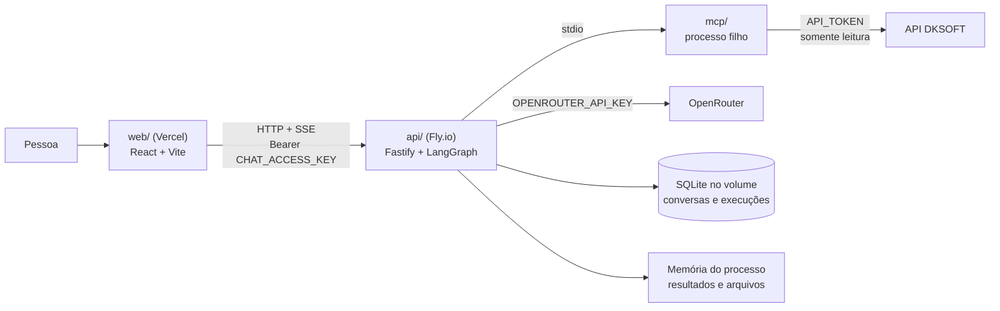

# dksoft-ia-chat

Chat de IA para consultar a API DKSOFT em linguagem natural: alunos, pacotes, contas a receber e contas pagas. O assistente responde em streaming, mostra gráficos e gera arquivos PDF, Excel e Word a partir das consultas.

- [Como funciona](#como-funciona)
- [Decisões de arquitetura](#decisões-de-arquitetura)
- [Estrutura do projeto](#estrutura-do-projeto)
- [Rodar localmente](#rodar-localmente)
- [Testes e qualidade](#testes-e-qualidade)
- [Redeploy](#redeploy)
- [Diagnóstico de problemas](#diagnóstico-de-problemas)
- [Configuração](#configuração)
- [API (resumo)](#api-resumo)
- [Arquivos e gráficos](#arquivos-e-gráficos)
- [Limitações conhecidas](#limitações-conhecidas)
- [Como contribuir](#como-contribuir)

## Como funciona



1. A pessoa informa a chave de acesso e envia uma pergunta pelo front.
2. O `POST /chat` abre um stream SSE e roda o agente LangGraph sobre o OpenRouter.
3. O agente chama as tools do MCP, que consultam a API DKSOFT.
4. O resultado completo fica em memória, e o modelo recebe apenas uma versão reduzida.
5. Texto, avisos de consulta, gráficos e arquivos chegam ao front como eventos SSE.

## Decisões de arquitetura

As regras completas estão na [constitution](.specify/memory/constitution.md). Estas são as decisões que mais afetam quem mantém o projeto.

### Agente e dados

| Decisão | Por quê | Consequência |
|---------|---------|--------------|
| MCP como processo filho da API, via stdio | O agente consome as mesmas tools do servidor MCP, sem expor outro serviço na rede | API e MCP são publicados juntos, na mesma imagem Docker |
| API DKSOFT somente leitura | Nenhuma tool do agente altera dados | O agente só consulta; as tools locais geram gráficos e arquivos, sem escrever na DKSOFT |
| O modelo vê poucas linhas; o resultado completo fica guardado | Reduz custo e contexto (`TOOL_RESULT_MAX_ROWS`) sem limitar a exportação | Gráficos e arquivos usam os registros guardados, não valores digitados pelo modelo |
| Modelo de reserva e novas tentativas | Uma falha temporária do provedor não deve derrubar a conversa | `OPENROUTER_MODEL_FALLBACK` igual ao modelo principal é ignorado, ou seja, fica sem reserva |
| Limites para a API DKSOFT e por minuto no chat | Protege a API externa e o custo | Ajustáveis em `DKSOFT_MAX_*`, `CHAT_RATE_LIMIT_PER_MIN` e `EXPORT_RATE_LIMIT_PER_MIN` |

### Persistência

| Decisão | Por quê | Consequência |
|---------|---------|--------------|
| SQLite (`node:sqlite`) em volume do Fly | Sem servidor de banco externo no MVP | **Apenas uma máquina**: o volume não é compartilhado |
| Resultados e arquivos só em memória, com expiração | Dados pessoais de alunos não vão para disco | Reinício ou deploy apaga tudo que estava vivo; as conversas continuam no SQLite |
| Geração de arquivos em `worker_threads` | PDF e Word não podem travar o laço principal, que atende o streaming | A concorrência é limitada por `EXPORT_MAX_CONCURRENCY` |
| Feature flag `ARTIFACTS_ENABLED` | Desliga exportação e gráficos sem novo deploy | Com `false`, não existe rota, tool nem evento novo |

### Segurança

| Decisão | Por quê | Consequência |
|---------|---------|--------------|
| Segredos só no backend | `API_TOKEN` e `OPENROUTER_API_KEY` não chegam ao front, ao prompt, às respostas nem aos logs | O front recebe apenas a URL pública da API |
| Uma chave de acesso compartilhada | Escopo de MVP: um token, sem multi-tenant nem perfis | Quem tem a chave vê todos os dados daquele token |
| Chave em `sessionStorage`, comparada em tempo constante | Some ao fechar a aba e não vaza pelo tempo de resposta | A pessoa redigita a chave a cada sessão |
| CORS por allowlist exata | Só as origens autorizadas chamam a API | URLs de preview da Vercel ficam bloqueadas, a não ser que sejam adicionadas |
| Dados pessoais mascarados por padrão | O botão **Exportar** nunca gera CPF, e-mail ou telefone completos | Dados completos exigem pedido escrito e explícito no chat |

### Código e hospedagem

| Decisão | Por quê | Consequência |
|---------|---------|--------------|
| Camadas `http/` → `services/` → `store/` e `agent/`, com `domain/` puro | O domínio é testável sem mocks pesados | IO fica fora do `domain/` |
| Front em `components → hooks → (api, storage) → lib`, com `lib` puro | A lógica fica testável e os componentes, finos | Regra nova do front nasce em `lib/` com teste |
| zod em toda fronteira | HTTP, env, eventos e respostas externas viram dados tipados | Configuração inválida impede a API de subir |
| Erros de domínio como classes | A tradução para HTTP ou SSE fica só na borda | Veja [`api/src/http/errors.ts`](api/src/http/errors.ts) |
| Front e back em provedores separados | Vercel entrega o SPA; o Fly mantém o processo com volume e SSE | Podem ser publicados em qualquer ordem: o front ignora eventos que não conhece |
| API roda TypeScript direto via `tsx` | Dispensa etapa de build no backend | A imagem instala as devDependencies |

## Estrutura do projeto

```text
.
├── api/                  Backend do agente (spec 001)
│   ├── assets/fonts/     Fontes Archivo embarcadas nos arquivos gerados
│   └── src/
│       ├── agent/        Agente LangGraph, modelo, middlewares e tools locais
│       ├── domain/       Regras puras: tabelas, gráficos, máscara de dados, erros
│       ├── http/         Fastify: rotas, autenticação, CORS, SSE, tradução de erros
│       ├── obs/          Logger
│       ├── render/       Geração de PDF, Word, Excel e PNG em worker threads
│       ├── services/     Casos de uso: chat, exportação, gráficos, limitadores
│       ├── store/        SQLite e armazenamento em memória
│       ├── config.ts     Validação das variáveis de ambiente
│       └── index.ts      Composição e inicialização
├── mcp/                  Servidor MCP (stdio) que expõe a API DKSOFT como tools
│   └── src/              application, domain, infrastructure e mcp/tools
├── web/                  Front do chat (spec 002): pacote npm separado
│   ├── e2e/              Testes E2E com servidor falso do contrato
│   └── src/
│       ├── api/          Cliente HTTP e leitura do stream SSE
│       ├── components/   Componentes React
│       ├── hooks/        Estado e orquestração
│       ├── lib/          Lógica pura
│       ├── pages/        Página do chat
│       └── storage/      Chave de acesso e tema
├── data/                 Contrato da API DKSOFT (openapi.json, api-types.ts)
├── specs/                Specs, planos e tarefas do Spec Kit
├── Dockerfile            Imagem única com api/ e mcp/
├── fly.toml              Configuração do Fly.io
└── DEPLOY.md             Guia do primeiro deploy e validação
```

## Rodar localmente

Pré-requisito: Node 24 LTS.

```bash
npm --prefix mcp install
npm --prefix api install
npm --prefix web install

cp api/.env.example api/.env   # preencha as variáveis obrigatórias (veja Configuração)
npm --prefix api run dev       # API na porta 3000; sobe o MCP como processo filho
npm --prefix web run dev       # front em http://localhost:5173
```

Gere uma chave de acesso válida com `openssl rand -hex 32`. Para trabalhar só no front, sem API real, veja [`specs/002-chat-web-ui/quickstart.md`](specs/002-chat-web-ui/quickstart.md).

## Testes e qualidade

| Pacote | Comandos |
|--------|----------|
| `api/` | `npm --prefix api test` · `npm --prefix api run typecheck` |
| `web/` | `npm --prefix web test` · `npm --prefix web run typecheck` · `npm --prefix web run lint` · `npm --prefix web run build` |
| `web/` (E2E) | `npm --prefix web run test:e2e` |
| `mcp/` | `npm --prefix mcp test` |

Testes usam `node:test` via `tsx` e não acessam a rede: modelo, MCP e API DKSOFT são substituídos por fakes. Testes e typecheck precisam estar verdes antes de qualquer commit.

## Redeploy

| Parte | Onde | Como publicar |
|-------|------|---------------|
| Backend + MCP | Fly.io, app `dksoft-ia-chat-api-demo`, região `gru` | `fly deploy` na raiz do repositório |
| Front | Vercel, Root Directory `web` | Push na Production Branch do projeto |

O primeiro deploy (criar app, volume e segredos) está em [`DEPLOY.md`](DEPLOY.md). Se `fly` não estiver no `PATH`, use `~/.fly/bin/flyctl`.

### Backend

O `fly deploy` publica **o que está no disco**, então confira a branch antes:

```bash
git switch master && git pull
fly deploy
curl https://dksoft-ia-chat-api-demo.fly.dev/health   # {"status":"ok"}
fly status
```

O deploy reinicia a máquina e apaga resultados e arquivos em memória. Conversas não são afetadas.

### Front

1. Faça o merge na branch configurada em *Settings → Git → Production Branch*. A Vercel publica sozinha.
2. Para publicar de novo sem mudar código, use *Deployments → último deploy → ⋯ → Redeploy*.

`VITE_API_BASE_URL` é lida no build: se mudar, é preciso um novo deploy do front.

### Alterar configuração

```bash
fly secrets set EXPORT_MAX_ROWS=3000                 # aplica e reinicia a máquina
fly secrets set CHAT_ACCESS_KEY="$(openssl rand -hex 32)"
fly secrets set CHAT_CORS_ORIGINS=https://novo-dominio
```

Guarde a nova `CHAT_ACCESS_KEY`: o Fly não mostra o valor de novo. `CHAT_CORS_ORIGINS` precisa ser a origem exata, com `https://` e sem barra final.

### Reverter

| O que reverter | Como |
|----------------|------|
| Só exportação e gráficos | `fly secrets set ARTIFACTS_ENABLED=false` |
| Versão do backend | `fly releases --image` e depois `fly deploy --image <imagem-anterior>` |
| Versão do front | *Deployments → versão anterior → Promote to Production* |
| Pausar o backend | `fly scale count 0` |

### Conferir depois do deploy

1. `GET /health` responde `{"status":"ok"}`.
2. Uma chave errada mostra "Chave incorreta", e a certa entra.
3. Uma pergunta como "Quais pacotes estão disponíveis?" responde em streaming.
4. Recarregar em `/c/<uuid>` reabre o histórico.
5. **Exportar → Excel** gera o arquivo com dados pessoais mascarados.

O roteiro completo está em [`DEPLOY.md`](DEPLOY.md#3-validação).

## Diagnóstico de problemas

Comece sempre por aqui:

```bash
fly logs --no-tail                 # últimas linhas
fly status                         # estado da máquina
fly machine status <id-da-máquina> # histórico de início e parada
```

Toda requisição tem um `reqId`. O código de suporte mostrado no front é esse valor, então dá para buscá-lo nos logs. O log registra rota e status, mas não o corpo da resposta.

| Sintoma | Causa | O que fazer |
|---------|-------|-------------|
| `machine ID … lease currently held by …` nos logs | Normalmente é efeito de outro problema: o proxy tenta religar uma máquina que está em operação | Procure a causa nos logs anteriores; o lease expira sozinho |
| `machine has reached its max restart count of 10` | O processo saiu com erro 10 vezes seguidas | Procure `Falha ao iniciar` nos logs |
| `Configuração inválida: …` | Variável ausente ou fora da regra de [`config.ts`](api/src/config.ts) | Corrija com `fly secrets set` |
| `Trial machine stopping. To run for longer than 5m0s…` | Conta do Fly em trial: a máquina é parada 5 minutos após cada início | Adicione um cartão em <https://fly.io/trial> |
| "Este link expirou" ou "Os dados dessa consulta não estão mais disponíveis" | Prazo vencido, reinício da máquina ou limite por conversa | Refaça a pergunta e exporte em seguida |
| Exportar funciona, mas falha com **Incluir gráfico** | `chart_not_found`: o gráfico não pertence ao resultado exportado | Refaça o gráfico sobre a consulta que será exportada |
| Front bloqueado por CORS | A origem não está em `CHAT_CORS_ORIGINS` | Adicione a origem exata; previews da Vercel têm URL própria |
| Primeira resposta demora vários segundos | A máquina estava parada e está subindo | Com o trial removido, ela deve permanecer ligada |

## Configuração

As variáveis são validadas em [`api/src/config.ts`](api/src/config.ts); os exemplos estão em [`api/.env.example`](api/.env.example). Localmente ficam em `api/.env`. Em produção, os segredos ficam no Fly e `BASE_URL`, `PORT`, `CHAT_DB` e `TRUST_PROXY` estão no `fly.toml`.

**Obrigatórias**

| Variável | Regra |
|----------|-------|
| `OPENROUTER_API_KEY` | Chave do OpenRouter |
| `OPENROUTER_MODEL` | Modelo principal |
| `API_TOKEN` | Token da API DKSOFT |
| `BASE_URL` | URL terminada em `/api/v1` |
| `CHAT_ACCESS_KEY` | **Pelo menos 32 caracteres** |

**Opcionais**

| Variável | Padrão | Uso |
|----------|--------|-----|
| `OPENROUTER_MODEL_FALLBACK` | vazio | Modelo de reserva |
| `CHAT_CORS_ORIGINS` | `http://localhost:5173` | Origens permitidas, separadas por vírgula |
| `CHAT_DB` | `./data/chat.db` | Caminho do SQLite |
| `PORT` | `3000` | Porta da API |
| `TRUST_PROXY` | `false` | Use `true` atrás do proxy do Fly: o limite por minuto passa a valer por IP de cliente |
| `MCP_ENTRY` | `../mcp/src/index.ts` | Entrada do servidor MCP |
| `CHAT_TIMEOUT_MS` | `120000` | Tempo máximo de uma resposta |
| `CHAT_HISTORY_LIMIT` | `12` | Limite de mensagens do histórico usadas no contexto |
| `CHAT_RATE_LIMIT_PER_MIN` | `30` | Limite do chat por minuto |
| `DKSOFT_MAX_CONCURRENCY` | `4` | Chamadas simultâneas à DKSOFT (máximo 5) |
| `DKSOFT_MAX_PER_MINUTE` | `50` | Chamadas por minuto à DKSOFT (máximo 60) |
| `TOOL_RESULT_MAX_ROWS` | `40` | Linhas enviadas ao modelo por consulta |
| `ARTIFACTS_ENABLED` | `true` | Liga exportação e gráficos |
| `RESULT_TTL_MS` | `3600000` | Validade dos dados da consulta (1 h) |
| `RESULT_MAX_ROWS` | `20000` | Linhas guardadas por resultado |
| `RESULT_STORE_MAX_MB` | `64` | Memória para resultados |
| `EXPORT_TTL_MS` | `1800000` | Validade do arquivo (30 min) |
| `EXPORT_MAX_ROWS` | `5000` | Linhas por arquivo |
| `EXPORT_TIMEOUT_MS` | `30000` | Tempo máximo de geração |
| `EXPORT_MAX_CONCURRENCY` | `2` | Gerações simultâneas |
| `FILE_STORE_MAX_MB` | `96` | Memória para arquivos |
| `EXPORT_RATE_LIMIT_PER_MIN` | `20` | Limite de exportações por minuto |

**Front**

| Variável | Uso |
|----------|-----|
| `VITE_API_BASE_URL` | URL pública da API. Entra no bundle, então nunca coloque chaves aqui |

## API (resumo)

Todas as rotas, exceto `GET /health`, exigem `Authorization: Bearer <CHAT_ACCESS_KEY>`.

| Rota | Uso |
|------|-----|
| `GET /health` | Verificação de saúde |
| `POST /chat` | Envia uma mensagem e responde em SSE |
| `GET /conversations` | Lista conversas |
| `GET /conversations/:id/messages` | Mensagens de uma conversa |
| `POST /exports` | Gera um arquivo a partir de um resultado |
| `GET /conversations/:conversationId/exports/:fileId` | Baixa um arquivo |

```bash
curl -N http://localhost:3000/chat \
  -H "Authorization: Bearer $CHAT_ACCESS_KEY" -H "content-type: application/json" \
  -d '{"message":"Quais parcelas em aberto o aluno 1234 tem?"}'
```

Eventos SSE: `meta`, `tool`, `result`, `chart`, `file`, `token` e, ao final, `done` ou `error`. Contratos completos em [`specs/001-agent-api/contracts/http.md`](specs/001-agent-api/contracts/http.md) e [`specs/004-exportacao-graficos/contracts/`](specs/004-exportacao-graficos/contracts/).

## Arquivos e gráficos

O assistente gera **PDF, Excel (.xlsx) e Word (.docx)** a partir de uma consulta e mostra **gráficos** de barras, linhas e pizza quando ajudam.

- **Pelo chat**: "me manda isso em Excel", "exporta em PDF com o gráfico". O arquivo aparece como um cartão com nome, formato, tamanho, linhas e validade.
- **Pelo botão Exportar** da resposta: PDF, Excel ou Word, com **Incluir gráfico** quando há um gráfico daquele resultado.
- **Dados pessoais** (CPF, e-mail, telefone) saem mascarados. Só um pedido escrito explícito ("com o CPF completo") gera o arquivo completo; o botão nunca gera.
- **Conversas reabertas** mostram os gráficos, mas não exportam: refaça a pergunta.

Quanto tempo cada item fica disponível:

| Item | Validade | Limite por conversa | Memória total |
|------|----------|---------------------|---------------|
| Dados da consulta | 1 h | 10 resultados | 64 MB |
| Arquivo gerado | 30 min | 20 arquivos | 96 MB |

Ao passar desses limites, os itens mais antigos são descartados antes do prazo. Tudo é perdido em reinícios e deploys. Detalhes de desempenho em [`perf-notes.md`](specs/004-exportacao-graficos/perf-notes.md).

## Limitações conhecidas

- **Conta do Fly em trial (situação em 01/11/2026):** a máquina é parada 5 minutos após cada início e religa na requisição seguinte. Isso apaga resultados e arquivos e pode interromper respostas em andamento. Resolver isso exige adicionar um cartão à conta.
- **Uma máquina só:** não rode `fly scale count 2`. O SQLite está no volume, e os arquivos ficam na memória de cada processo.
- **Links não sobrevivem a reinícios:** cards antigos continuam na tela depois de um reinício, mas os dados deles já foram perdidos.
- **Um token, sem multi-tenant:** quem tem a chave de acesso vê os dados daquele token. Prefira um token de escola de teste nas demos.
- **Custo:** defina um limite de gasto na conta do OpenRouter.
- **Container como root:** necessário para escrever no volume montado.
- **Exclusão do volume:** destruir o volume apaga todas as conversas.

## Como contribuir

- Trabalhe em branch `feat/NNN-nome`, nunca direto na `master`.
- Siga o Spec Kit em mudanças relevantes: `/speckit-specify` → `/speckit-plan` → `/speckit-tasks` → `/speckit-implement`.
- Lógica nova nasce com teste, e cada tarefa cabe em um commit.
- Nunca commite segredos nem `.env`.
- O design do front segue [`.github/instructions/design.instructions.md`](.github/instructions/design.instructions.md).

| Spec | Documentos |
|------|------------|
| 001, API do agente | [spec](specs/001-agent-api/spec.md) · [plano](specs/001-agent-api/plan.md) · [tarefas](specs/001-agent-api/tasks.md) · [quickstart](specs/001-agent-api/quickstart.md) |
| 002, Front do chat | [spec](specs/002-chat-web-ui/spec.md) · [plano](specs/002-chat-web-ui/plan.md) · [tarefas](specs/002-chat-web-ui/tasks.md) · [quickstart](specs/002-chat-web-ui/quickstart.md) |
| 004, Exportação e gráficos | [spec](specs/004-exportacao-graficos/spec.md) · [plano](specs/004-exportacao-graficos/plan.md) · [tarefas](specs/004-exportacao-graficos/tasks.md) · [quickstart](specs/004-exportacao-graficos/quickstart.md) |
